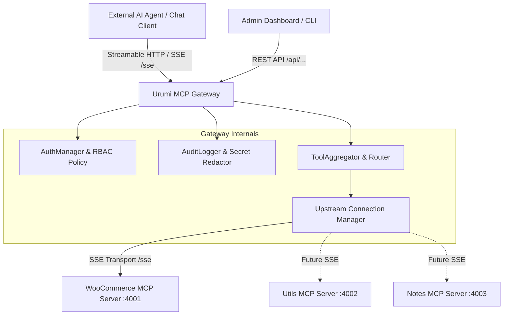

# Urumi AI Model Context Protocol (MCP) Gateway (`gateway`)

The **Urumi MCP Gateway** serves as a secure, authenticated, collision-resistant reverse proxy and protocol aggregator for upstream MCP servers (`woo-mcp`, `utils-mcp`, `notes-mcp`).

---

## 🏗️ Architecture & Component Topology

---

## 🔒 Security & Role-Based Access Control (RBAC)

1. **Hashed API Key Authentication:** Keys are stored as SHA-256 / HMAC digests. Incoming keys are verified using `crypto.timingSafeEqual` to prevent side-channel timing attacks.
2. **Role Enforcement:**
   - **`admin`**: Full access to all tool executions, server management (`/api/servers`), API key generation (`/api/auth/keys`), and audit log viewing (`/api/audit-logs`).
   - **`member`**: Read-only access to query tools and execute read operations (`list_products`, `list_orders`, `get_order`). Mutating operations (`create_product`, `update_order_status`) return `403 Forbidden`.
3. **Audit Logging & Redaction:** All tool invocations and administrative actions are logged with caller metadata and execution duration. All API keys, consumer secrets, tokens, and Authorization headers are automatically redacted.

---

## 🚀 REST API Reference

| Endpoint | Method | Role | Description |
|---|---|---|---|
| `/healthz` | `GET` | Public | Liveness and readiness health probe. |
| `/api/tools` | `GET` | Member / Admin | List aggregated tools across enabled upstream servers. |
| `/api/tools/execute` | `POST` | Member / Admin | Execute an aggregated tool with role-based validation. |
| `/api/servers` | `GET`, `POST` | Admin | List or register upstream MCP servers. |
| `/api/servers/:id/toggle` | `POST` | Admin | Enable or disable an upstream server dynamically. |
| `/api/audit-logs` | `GET` | Admin | Query sanitized audit trail logs. |
| `/api/auth/keys` | `GET`, `POST` | Admin | List active key metadata or generate new API keys. |
| `/sse` / `/mcp` | `GET`, `POST` | All MCP Clients | Standard Streamable HTTP / SSE MCP server endpoint. |
