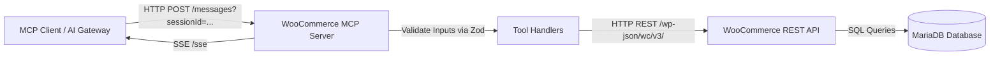

# WooCommerce MCP Server (`woo-mcp`)

The **WooCommerce Model Context Protocol (MCP) Server** exposes safe, structured, and validated tools allowing AI agents and gateways to interact with the WooCommerce store over standard MCP Streamable HTTP / Server-Sent Events (SSE).

---

## 🛠️ Implemented MCP Tools

| Tool Name | Parameters | Description |
|---|---|---|
| [`list_products`](file:///apps/woo-mcp/src/tools.ts#L12) | `page?`, `per_page?`, `search?` | Lists products with pagination and search text filter. Returns ID, name, price, regular price, status, and stock status. |
| [`create_product`](file:///apps/woo-mcp/src/tools.ts#L43) | `name`, `price`, `description?`, `sku?` | Validates non-empty name & non-negative price, creating a simple product in WooCommerce. |
| [`list_orders`](file:///apps/woo-mcp/src/tools.ts#L80) | `page?`, `per_page?`, `after?`, `before?` | Lists orders with pagination and ISO date range filters (`YYYY-MM-DD` or ISO 8601). Returns order ID, date, status, total, currency, and customer details. |
| [`get_order`](file:///apps/woo-mcp/src/tools.ts#L119) | `id` | Validates positive integer order ID and retrieves complete order details or a structured not-found error. |
| [`update_order_status`](file:///apps/woo-mcp/src/tools.ts#L151) | `id`, `status` | Validates order ID and status against strict allowed enum (`pending`, `processing`, `on-hold`, `completed`, `cancelled`, `refunded`, `failed`, `trash`). |

---

## 🏗️ Architecture & Request Flow



---

## 🔒 Security & Credential Handling

- **Zero Database Exposure:** The MCP server does not connect directly to MariaDB. It uses the officially supported WooCommerce REST API (`/wp-json/wc/v3/`).
- **Kubernetes Secrets:** `consumer-key` and `consumer-secret` are injected at runtime from the `woo-mcp-secret` Kubernetes Secret.
- **Log Sanitization:** Raw keys, tokens, and Authorization headers are never logged.
- **Internal Cluster Isolation:** The service is deployed with a `ClusterIP` Service only and has no public Ingress.

---

## 🧪 Local Testing & Verification

### Run Unit Tests
```bash
npm test
```

### Build Production Bundle
```bash
npm run build
```
