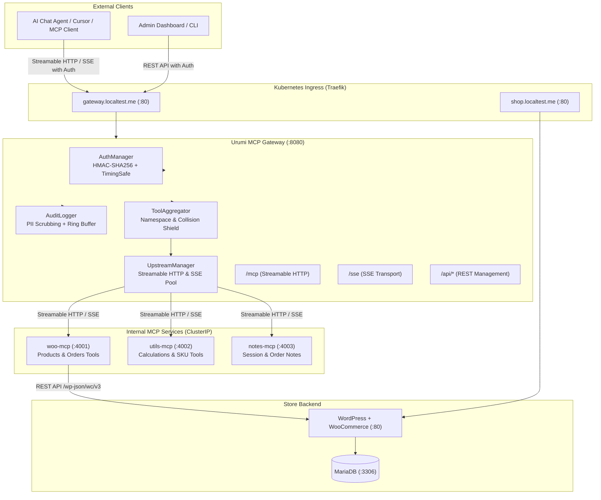

# Architecture Overview

## Summary
The **Urumi AI MCP Gateway** is a reverse proxy, protocol router, and security enforcement layer providing unified, authenticated Model Context Protocol (MCP) access to e-commerce and store operations.

## High-Level Topology

## Transport Architecture
1. **MCP Streamable HTTP (`POST /mcp`):**
   - The primary modern transport conforming to MCP specification (`@modelcontextprotocol/sdk`).
   - Stateful session tracking using `Mcp-Session-Id` header with automatic session cleanup.
   - Authentication enforced via `Authorization: Bearer <key>` header or `?apiKey=<key>`.
2. **MCP Server-Sent Events (`GET /sse`, `POST /messages`):**
   - Maintained for backwards compatibility with legacy MCP clients and browser EventSource consumers.
   - Authenticated via query parameter `?apiKey=<key>` or `Authorization` header.
3. **Gateway REST API (`/api/*`):**
   - Direct HTTP endpoints for tool execution, catalog discovery, audit logs, and server management.

## Component Responsibilities
- **Gateway:** Protocol dispatch, authentication, RBAC, tool aggregation, upstream health checking, audit logging.
- **woo-mcp:** Bridges MCP requests to the WooCommerce REST API (`/wp-json/wc/v3`). Zero direct database access.
- **utils-mcp:** Provides stateless utilities (discounts, currency conversion, SKU generation).
- **notes-mcp:** Manages session notes and annotations for order auditing.
